<p align="center">
  <picture>
    <source media="(prefers-color-scheme: dark)" srcset="docs/brand/stelleye-logo-dark.png">
    
  </picture>
</p>

<h3 align="center">Eyes on call for visually impaired people, paid on Stellar worldwide.</h3>
<p align="center">HackMeridian 2026 · Genesis · Stellar Composed</p>

<table align="center">
  <tr>
    <td align="center" width="230">
      <br>
      <b>Scan to try it</b>
    </td>
    <td>
      <b><a href="https://samanhazemijebelli--stelleye.us-east.modal.run">Live demo</a></b> on Stellar testnet<br><br>
      1. Sign in as <b>Ana</b> (guide) and tap <i>Go online</i>.<br>
      2. In a second window, sign in as <b>Maria</b> (caller), open <i>Guides → Online now</i> and call Ana.<br><br>
      <b>For judges:</b>
      <a href="https://samanhazemijebelli--stelleye.us-east.modal.run/llms.txt">llms.txt</a> ·
      <a href="https://samanhazemijebelli--stelleye.us-east.modal.run/robots.txt">robots.txt</a> ·
      <a href="https://samanhazemijebelli--stelleye.us-east.modal.run/sitemap.xml">sitemap.xml</a> ·
      <a href="docs/pitch/stelleye-pitch-deck.pdf">pitch deck (PDF)</a> ·
      <a href="https://stellar.expert/explorer/testnet/contract/CAYXBP4DF3SG2J3224M6HA7X3OXVUCL2XLP3EWPPJ6LTX6UPFMBVUPTP">CallEscrow on stellar.expert</a>
    </td>
  </tr>
</table>

## The problem

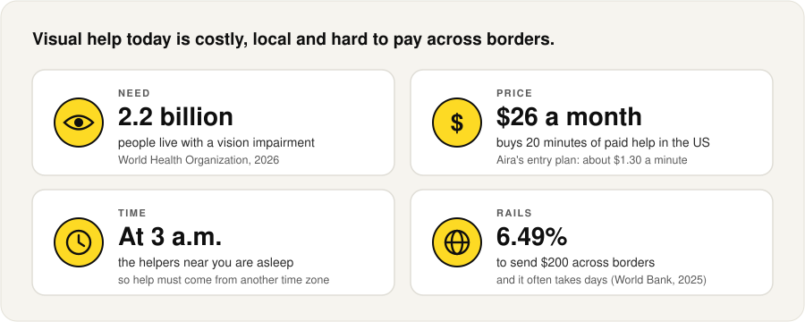

<table>
  <tr>
    <td width="300"></td>
    <td><b>Low vision can turn a medicine label into this.</b><br><br>Who it hurts: visually impaired people who just need a quick look, at any hour, anywhere.</td>
  </tr>
</table>

<sub>Sources: <a href="https://www.who.int/news-room/fact-sheets/detail/blindness-and-visual-impairment">WHO</a> · <a href="https://aira.io/subscriptions/">Aira</a> · <a href="https://remittanceprices.worldbank.org/sites/default/files/rpw_main_report_and_annex_q125_1_0.pdf">World Bank</a></sub>

## The solution

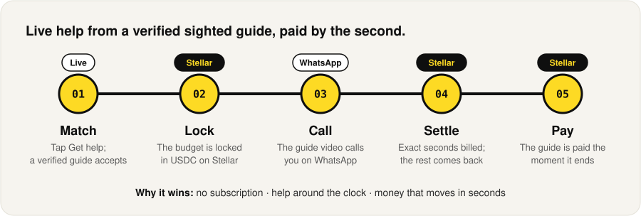

<p align="center">
  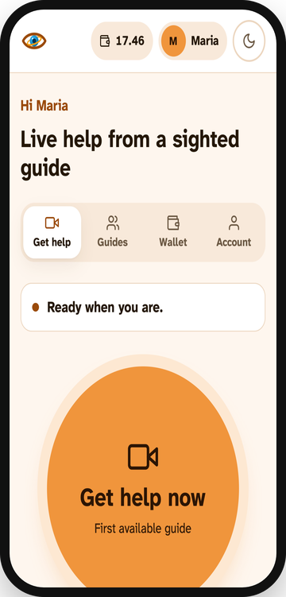
  &nbsp;&nbsp;
  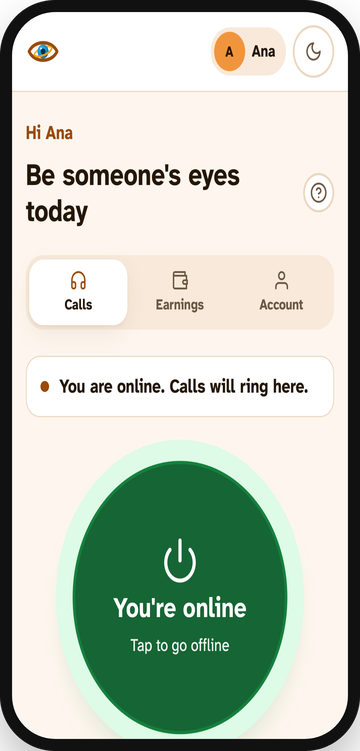
</p>

### A call, second by second

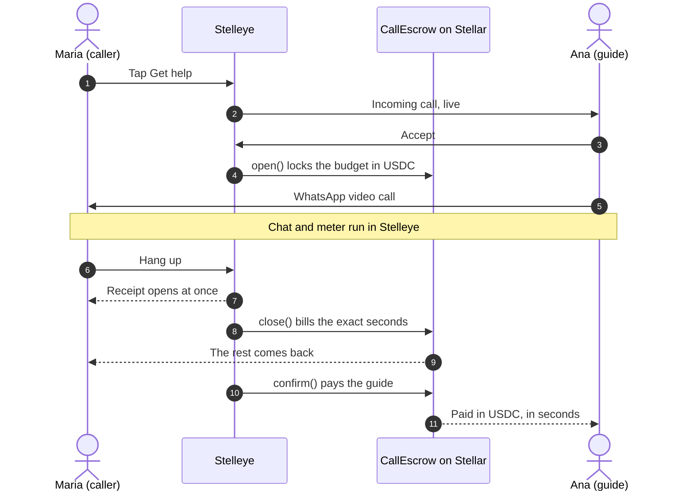

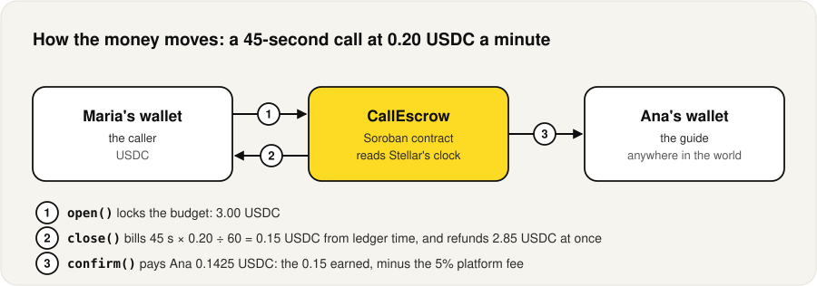

## Market

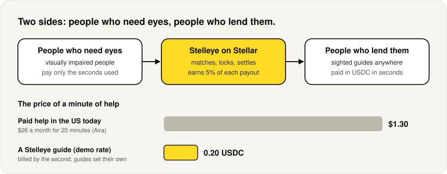

**Why now:** stablecoins and Stellar make tiny global payouts practical.

## Roadmap

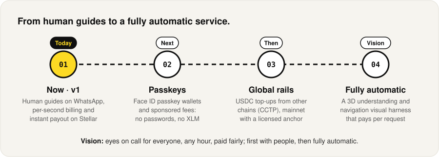

## Team

**Saman Hazemijebelli** · Founder · full-stack and Soroban developer: a solo builder, end to end.

- Built Stelleye end to end: Soroban contract, Django app, Stellar money rails.
- Accessibility first: screen-reader first, WCAG contrast, 44 px touch targets.
- **Try it:** scan the code, sign in as Maria (caller) and Ana (guide), and make a call.

## Under the hood

<details>
<summary><b>Architecture</b></summary>
<br>

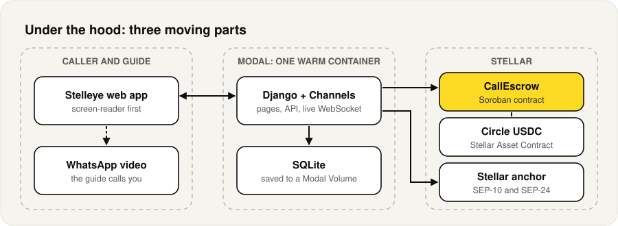

One live page per person keeps a call from ever running twice, and a reload during a paid call restores
the call screen, chat, meter and WhatsApp state.
</details>

<details>
<summary><b>Stellar integration</b></summary>
<br>

| Piece | Where |
|---|---|
| `CallEscrow` Soroban contract (Rust) | [`contracts/call_escrow/src/lib.rs`](contracts/call_escrow/src/lib.rs) |
| Deployed on testnet | [`CAYXBP4D…UPTP`](https://stellar.expert/explorer/testnet/contract/CAYXBP4DF3SG2J3224M6HA7X3OXVUCL2XLP3EWPPJ6LTX6UPFMBVUPTP) |
| Circle's testnet USDC (Stellar Asset Contract) | [`CBIELTK6…DAMA`](https://stellar.expert/explorer/testnet/contract/CBIELTK6YBZJU5UP2WWQEUCYKLPU6AUNZ2BQ4WWFEIE3USCIHMXQDAMA) |
| Anchor client: SEP-1, SEP-10 sign-in, SEP-24 deposit and withdrawal | [`server/stellar_bridge/anchor.py`](server/stellar_bridge/anchor.py), [`server/wallets/services.py`](server/wallets/services.py) |
| Contract client: simulate, sign, submit, decode | [`server/stellar_bridge/`](server/stellar_bridge/) |

Contract lifecycle: `verify_guide` (the on-chain guide registry) → `open` (lock the budget) → `close`
(per-second billing from ledger time, rounded up and capped at the budget; instant refund) → `confirm`
(the guide is paid at once, minus a 5% platform fee). The contract also carries `report` and `resolve`
for disputes. Every transaction is linked from the app to stellar.expert.
</details>

<details>
<summary><b>Run it locally</b></summary>
<br>

Needs Python 3.11, [uv](https://docs.astral.sh/uv/), Rust and the Stellar CLI.

```bash
cd contracts && stellar contract build && cd ../server
uv venv && uv pip install -r pyproject.toml
.venv/bin/python manage.py migrate
.venv/bin/python manage.py setup_testnet --asset-issuer GBBD47IF6LWK7P7MDEVSCWR7DPUWV3NY3DTQEVFL4NAT4AQH3ZLLFLA5
.venv/bin/python manage.py seed_demo                   # Maria, Ana, Kofi and a reviewer
.venv/bin/python manage.py runserver 8000 --nostatic
```
</details>

<details>
<summary><b>Deploy on Modal</b></summary>
<br>

```bash
modal volume create stelleye-data
modal secret create stelleye-env --from-dotenv server/.env DJANGO_SECRET_KEY="$(python3 -c 'import secrets; print(secrets.token_urlsafe(50))')"
modal deploy modal_app.py
```
One always-warm container serves the pages, the API and the live WebSocket; the database is saved to a
Modal Volume every few seconds.
</details>

<details>
<summary><b>Tests</b></summary>
<br>

```bash
cd server && uv pip install --group dev -r pyproject.toml && .venv/bin/python -m playwright install chromium webkit
.venv/bin/python manage.py test                 # 53 unit tests
.venv/bin/python e2e/run_e2e.py                 # the full journey on Stellar testnet, with accessibility scans
.venv/bin/python e2e/run_money.py               # Add money and Cash out through the anchor
.venv/bin/python e2e/responsive_sweep.py        # every page on laptops, iPad and phones, light and dark
.venv/bin/python e2e/live_check.py --base <url> # a real two-device call on any deployment
cd ../contracts && cargo test                   # 11 contract tests
```
</details>

<details>
<summary><b>The pitch deck</b></summary>
<br>

<a href="docs/pitch/stelleye-pitch-deck.pdf">Download the deck (PDF)</a>

<p>
  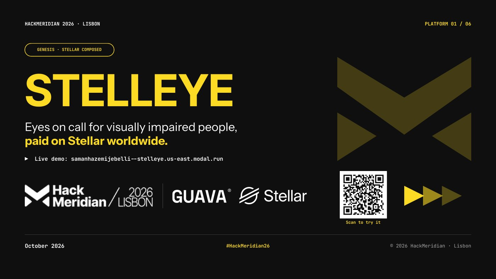
  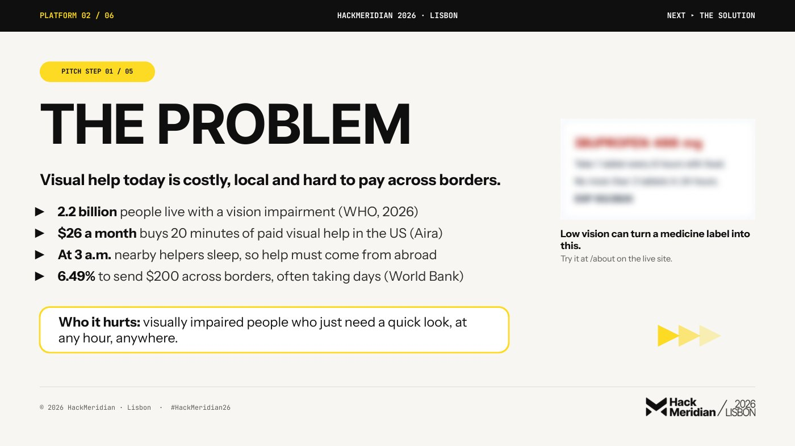
</p>
<p>
  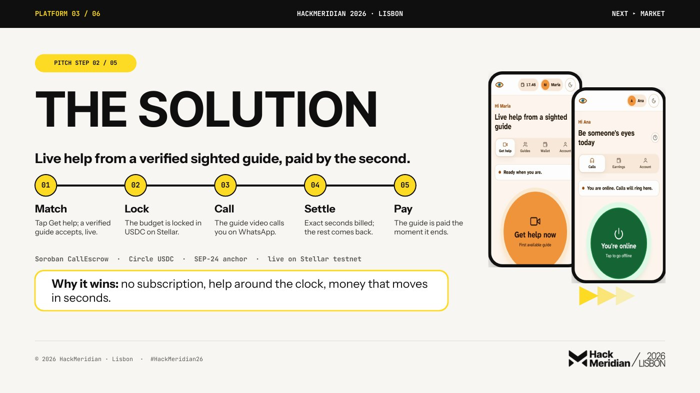
  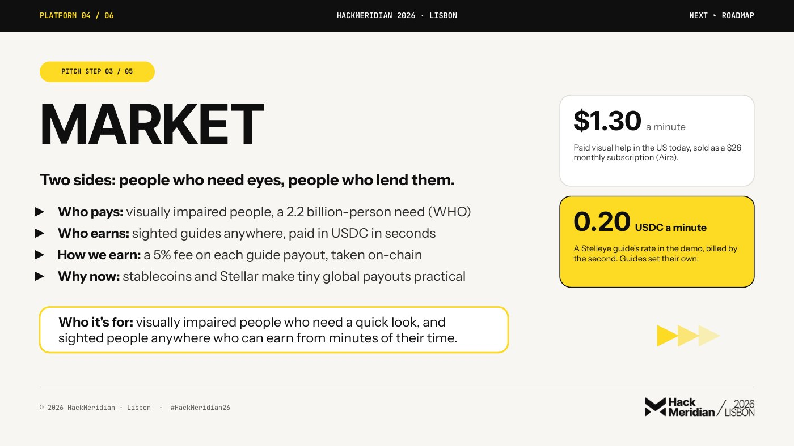
</p>
<p>
  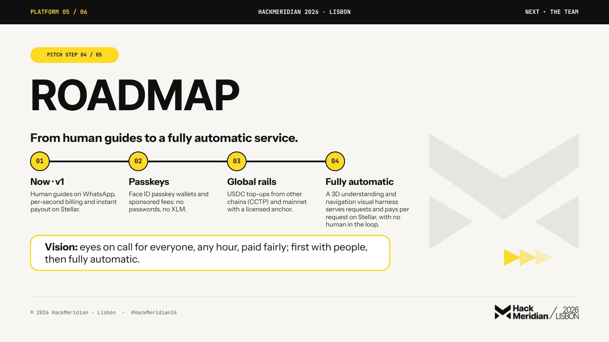
  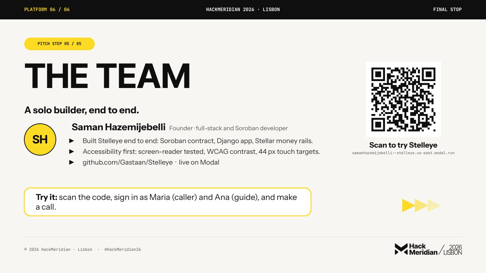
</p>
</details>
